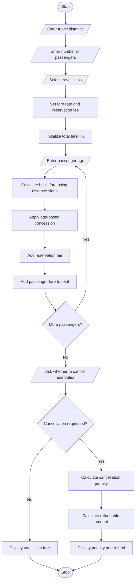

# Problem Statement
The Railway Fare and Reservation Calculator is a Python program designed to calculate railway ticket fares for multiple passengers. The program accepts the travel distance, number of passengers, travel class, passenger ages, reservation fees, and cancellation details as input. It calculates the basic fare using predefined distance slabs and class-based rates, applies age-based concessions for eligible passengers, adds reservation charges, and calculates cancellation penalties when applicable. Finally, it displays the total ticket fare, the cancellation penalty, and the final amount payable or refundable.
# Algorithm
1. Start the program.
2. Input the travel distance in kilometres.
3. Input the number of passengers.
4. Select the travel class: Sleeper, AC 3-Tier, or AC 2-Tier.
5. Determine the fare per kilometre based on the selected class.
6. Calculate the basic fare for each passenger using the distance slabs.
7. Input the age of each passenger.
8. Apply the appropriate concession for eligible children and senior passengers according to the program's predefined rules.
9. Add the reservation fee for each passenger.
10. Calculate the total fare for all passengers.
11. Ask whether the reservation should be cancelled.
12. If cancelled, calculate the cancellation penalty using the specified penalty rate.
13. Calculate the refundable amount after deducting the cancellation penalty.
14. Display the fare breakdown, total fare, cancellation penalty, and final amount.
15. Stop the program.
Note: The fare rates, concessions, reservation fees, and cancellation penalties below are illustrative values for this programming assignment, not actual Indian Railways fare rules.

# Sample Input
Consider a journey of 250 km in Sleeper class with three passengers.
RAILWAY FARE AND RESERVATION CALCULATOR
Enter travel distance in km: 250
Enter number of passengers: 3

Select Travel Class:
1. Sleeper
2. AC 3-Tier
3. AC 2-Tier
Enter your choice (1-3): 1

Passenger 1
Enter passenger age: 30
Passenger fare: Rs. 315.0

Passenger 2
Enter passenger age: 10
Passenger fare: Rs. 177.5

Passenger 3
Enter passenger age: 65
Passenger fare: Rs. 260.0

Do you want to cancel the reservation? (yes/no): yes

# Sample Output
========== FARE SUMMARY ==========
Travel Distance: 250 km
Travel Class: Sleeper
Number of Passengers: 3

Total Ticket Fare: Rs. 752.5

Cancellation Penalty: Rs. 188.12
Refundable Amount: Rs. 564.38

Thank you for using the calculator!

7. Calculation Verification
