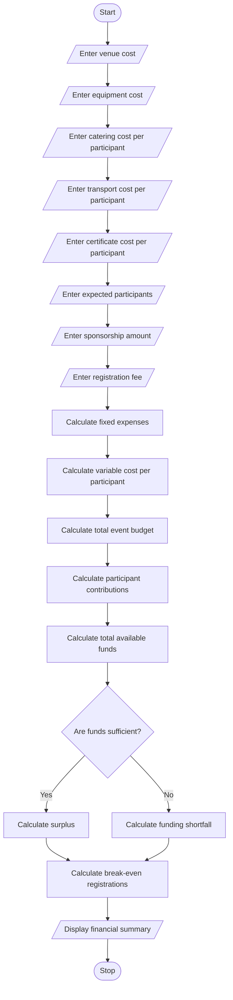

# Problem Statement
Develop a Python program for Campus Event Financial Planning to estimate and manage the expenses of a college event. The program should calculate the total event cost by considering venue rental, equipment charges, catering expenses, transportation costs, and certificate expenses. It should accept the expected number of participants, sponsorship amount, and registration fee per participant as inputs. Based on these values, the program should calculate the total budget, participant contributions, sponsorship shortfall, and minimum number of registrations required to break even. Finally, it should display a detailed financial summary to help event organizers plan their budget effectively.
# Algorithm
1. Start the program.
2. Input the venue rental cost.
3. Input equipment rental charges.
4. Input catering cost per participant.
5. Input transportation cost per participant.
6. Input certificate cost per participant.
7. Input the expected number of participants.
8. Input the available sponsorship amount.
9. Input the registration fee per participant.
10. Calculate the fixed expenses by adding venue and equipment costs.
11. Calculate the variable expenses per participant by adding catering, transportation, and certificate costs.
12. Calculate the total event budget using fixed expenses and variable expenses for all expected participants.
13. Calculate the total participant contribution using the registration fee and expected number of participants.
14. Calculate the total available funds by adding participant contributions and sponsorship.
15. Determine whether the available funds cover the total event budget.
16. If the available funds are insufficient, calculate the sponsorship shortfall.
17. Calculate the minimum number of registrations required to break even, considering sponsorship and the registration fee.
18. Display the total budget, expense breakdown, participant contributions, sponsorship amount, shortfall, and minimum break-even registration count.
19. Stop the program.
Assumption: All amounts are in Indian rupees (₹). The financial rules and sample figures are illustrative for this programming assignment.

# Sample Input
The following example assumes that the college expects 100 participants.
CAMPUS EVENT FINANCIAL PLANNING
Enter venue cost: Rs. 10000
Enter equipment cost: Rs. 5000
Enter catering cost per participant: Rs. 200
Enter transport cost per participant: Rs. 50
Enter certificate cost per participant: Rs. 30
Enter expected number of participants: 100
Enter sponsorship amount: Rs. 12000
Enter registration fee per participant: Rs. 400

# Sample Output
Minimum registrations required to break even: 25

========== EVENT FINANCIAL SUMMARY ==========
Venue Cost: Rs. 10000.0
Equipment Cost: Rs. 5000.0
Total Fixed Cost: Rs. 15000.0
Variable Cost per Participant: Rs. 280.0
Total Variable Cost: Rs. 28000.0
Total Event Budget: Rs. 43000.0
Participant Contributions: Rs. 40000.0
Sponsorship Amount: Rs. 12000.0
Total Available Funds: Rs. 52000.0
Sponsorship Shortfall: Rs. 0.0
Budget Surplus: Rs. 9000.0

Thank you for using the planner!
