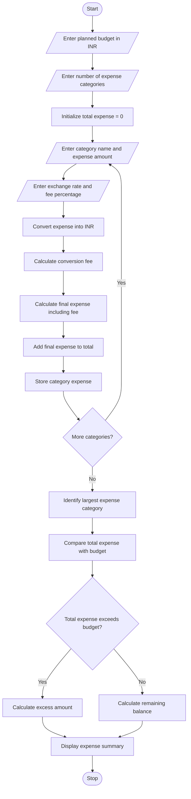

# Problem Statement
Develop a Python program for Multi-Currency Travel Budget Analysis that helps travellers manage expenses incurred in different countries and currencies. The program should accept travel expenses under different categories, such as accommodation, food, transportation, and shopping, along with their respective currencies and exchange rates. It should convert each expense into Indian Rupees using the supplied exchange rates, include currency conversion fees, and calculate the total travel expenditure. The program should compare the total expenditure against the planned budget, determine whether the traveller has exceeded the budget, calculate the remaining balance or excess amount, and identify the category with the highest spending.
# Algorithm
1. Start the program.
2. Input the planned travel budget in Indian Rupees.
3. Input the number of expense categories.
4. For each category:
   - Enter the category name.
   - Enter the expense amount in the original currency.
   - Enter the exchange rate to INR.
   - Enter the currency conversion fee percentage.
5. Convert the expense into INR using the supplied exchange rate.
6. Calculate the currency conversion fee.
7. Add the conversion fee to the converted expense.
8. Store the final expense for each category.
9. Calculate the total travel expenditure by adding all category expenses.
10. Identify the category with the highest total expense.
11. Compare the total expenditure with the planned budget.
12. If the expenditure is within the budget, calculate the remaining balance.
13. Otherwise, calculate the amount by which the budget has been exceeded.
14. Display the expense breakdown, conversion fees, total expenditure, largest expense category, and budget status.
15. Stop the program.

# Sample Input
Consider a traveller with a planned budget of ₹1,00,000 and four expense categories.
MULTI-CURRENCY TRAVEL BUDGET ANALYSIS
Enter planned travel budget in INR: Rs. 100000
Enter number of expense categories: 4

Expense Category 1
Enter category name: Accommodation
Enter expense amount in foreign currency: 500
Enter exchange rate to INR: 83
Enter conversion fee percentage: 2

Expense Category 2
Enter category name: Food
Enter expense amount in foreign currency: 200
Enter exchange rate to INR: 90
Enter conversion fee percentage: 1.5

Expense Category 3
Enter category name: Transport
Enter expense amount in foreign currency: 150
Enter exchange rate to INR: 105
Enter conversion fee percentage: 2

Expense Category 4
Enter category name: Shopping
Enter expense amount in foreign currency: 300
Enter exchange rate to INR: 83
Enter conversion fee percentage: 2

# Sample Output
========== TRAVEL BUDGET SUMMARY ==========

Planned Budget: Rs. 100000.0

Accommodation : Rs. 42330.0
Food : Rs. 18270.0
Transport : Rs. 16065.0
Shopping : Rs. 25398.0

Total Travel Expenditure: Rs. 102063.0

Largest Expense Category: Accommodation
Largest Category Expense: Rs. 42330.0

Budget Status: Budget Exceeded
Excess Amount: Rs. 2063.0

Thank you for using the travel budget analyzer!
